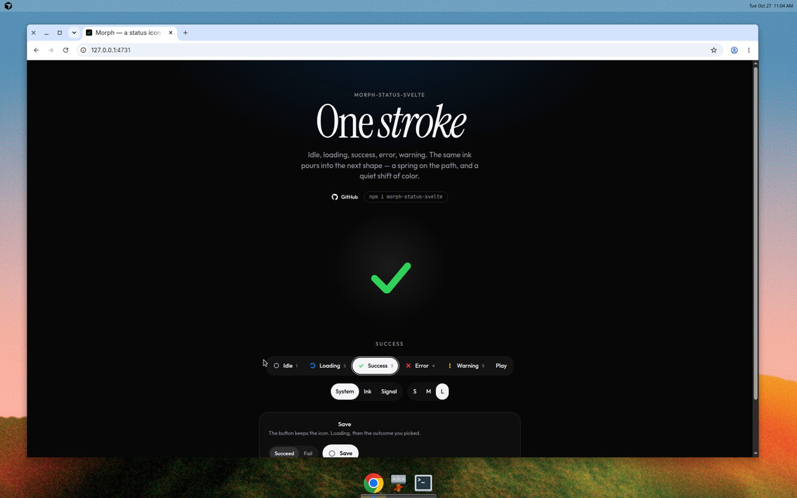

# morph-status-svelte

A status icon for Svelte 5. One stroke pours between idle, a spinner, a check, a cross, and a warning. The path is resampled so the spring can carry the same ink into the next shape, with a quiet color shift alongside.

**Live demo:** [morph-status-svelte.vercel.app](https://morph-status-svelte.vercel.app)



## Install

```bash
npm install morph-status-svelte
```

Peer dependency: `svelte` ^5.29 (the component uses `{@attach}`). The icon’s CSS ships inside the component. There are no other runtime dependencies.

## Usage

```svelte
<script lang="ts">
	import { MorphStatus, type StatusName } from 'morph-status-svelte';

	let phase = $state<StatusName>('idle');
</script>

<MorphStatus
	state={phase}
	size={32}
	strokeWidth={10}
	stiffness={0.2}
	damping={0.72}
	onchange={(next) => console.log('morph', next)}
	oncomplete={(next) => console.log('settled', next)}
/>
```

Keep the variable you pass out of the name `state` — a local called `state` collides with the `$state` rune.

A save button is the usual place it shows up. `announce={false}` leaves the accessible name to the button.

```svelte
<script lang="ts">
	import { MorphStatus, type StatusName } from 'morph-status-svelte';

	let phase = $state<StatusName>('idle');

	async function save() {
		phase = 'loading';
		const ok = await persist();
		phase = ok ? 'success' : 'error';
	}
</script>

<button type="button" onclick={save} disabled={phase === 'loading'}>
	<MorphStatus state={phase} size={22} announce={false} />
	{phase === 'loading' ? 'Saving' : 'Save'}
</button>
```

## Props

| Prop | Default | |
| --- | --- | --- |
| `state` | `'idle'` | `'idle' \| 'loading' \| 'success' \| 'error' \| 'warning'` |
| `size` | `32` | CSS pixels. The drawing is a 100×100 grid, so it stays sharp at any size. A non-finite value falls back to `32`. |
| `strokeWidth` | `10` | Stroke width in that 100×100 grid, clamped to `0.5–28`. |
| `colors` | light or dark set | Partial map of CSS colors per state: hex, `rgb()`, `hsl()`, `oklch()`, named, `currentColor` or `var(--token)`. |
| `stiffness` | `0.2` | Svelte spring stiffness, clamped to `0.02–1`. Higher is faster. |
| `damping` | `0.72` | Svelte spring damping, clamped to `0.05–1`. Lower overshoots. |
| `label` | — | One accessible name for every state. |
| `labels` | Idle, Loading, Success, Error, Warning | Accessible name per state. |
| `announce` | `true` | Polite live region. Set false inside a control that already has a name. |
| `onchange` | — | Called when a morph starts, after the first render. |
| `oncomplete` | — | Called when the shape settles on the new state. |
| `class` | — | Class on the root element. |

### Colors

The stroke is drawn in `currentColor`, and the icon's stylesheet sets `color` for the current state. Changing state eases the color over a CSS transition.

The defaults follow the page's [`color-scheme`](https://developer.mozilla.org/docs/Web/CSS/color-scheme): a light set (`DEFAULT_COLORS_LIGHT`) on light or unset schemes, and Apple's dark system set (`DEFAULT_COLORS_DARK`) on `color-scheme: dark`. Each holds at least 3:1 against its background (WCAG 1.4.11). Browsers without `light-dark()` get the light set.

Override a color per icon with `colors`, or for a whole subtree with CSS custom properties:

```svelte
<MorphStatus state={phase} colors={{ success: 'oklch(78% 0.17 160)', error: 'var(--danger)' }} />
```

```css
.toolbar {
	--morph-status-success: #63e6be;
	--morph-status-error: #ff375f;
	--morph-status-color-duration: 250ms; /* color transition, default 400ms */
}
```

`colors` wins over inherited custom properties. A value the browser does not parse as a color is ignored, and so is one containing `;`, braces or a comment. Under `forced-colors: active` (Windows High Contrast) the icon is drawn in the system text color, and the shape carries the state.

## Notes

- Each mark is one or two strokes with the same sample count. A single ribbon splits along its length when the next mark needs two strokes (the check breaking into a cross), so the shape pours instead of crossfading.
- Loading is an open arc on a spring, then a steady rotation. Leaving that state folds the current angle into the samples, so the next pour starts from the frame on screen.
- `prefers-reduced-motion: reduce` snaps the spring, holds the spinner still, and changes the color without a transition.
- Stiffness and damping are read on every change, including mid-morph. Very low damping can overshoot the stroke for a moment. That is the spring. The floors (`0.02` stiffness, `0.05` damping) keep every morph settling within a few seconds, so `oncomplete` always arrives. A numeric prop that is not a finite number falls back to its default.
- The icon is a live region (`role="status"`) whose label follows the state. Pass `label` for a single name, or `labels` to rename each one.

## Development

Requires Node `>=22.17` for development (`devEngines`). The published package has no Node requirement.

```bash
npm install
npm run dev
```

The demo serves at [http://127.0.0.1:4731](http://127.0.0.1:4731). `npm run build` builds the demo site. `npm run package` writes the library to `dist/` and runs publint. `npm test` runs the unit tests in Node and the component tests in jsdom. `npm run check` and `npm run lint` cover types and ESLint.

In this repo the demo imports the component through `#lib`. Published apps import `morph-status-svelte`.

`npm run verify` runs lint, types, tests and the package build, and runs before every publish. CI runs the same steps on Node 22 and 24, and also compiles the components with the oldest Svelte the peer range allows.

### Releasing

1. Bump `version` in `package.json` and move the `[Unreleased]` notes in `CHANGELOG.md` under a `## [x.y.z]` heading.
2. Push a tag `vx.y.z` on that commit. `.github/workflows/release.yml` checks the tag against `package.json` and the changelog, then publishes with npm trusted publishing and provenance. A prerelease such as `1.0.0-beta.1` goes to the `next` dist-tag.

## License

MIT © Emil Majer
