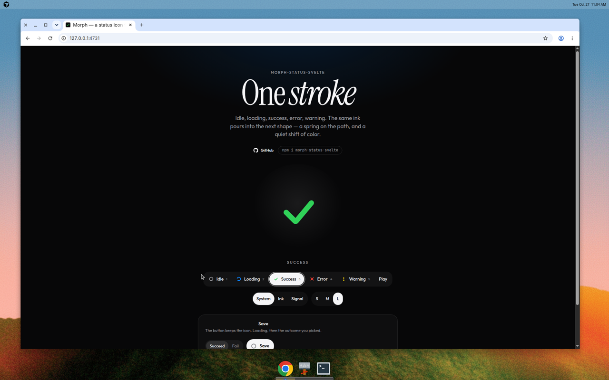

# morph-status-svelte

A status icon for Svelte 5. One stroke pours between idle, a spinner, a check, a cross, and a warning. The path is resampled so the spring can carry the same ink into the next shape, with a quiet color shift alongside.

**Live demo:** [morph-status-svelte.vercel.app](https://morph-status-svelte.vercel.app)



## Install

```bash
npm install morph-status-svelte
```

Peer dependency: `svelte` ^5. The icon’s CSS ships inside the component. There are no other runtime dependencies.

## Usage

```svelte
<script lang="ts">
	import { MorphStatus, type StatusName } from 'morph-status-svelte';

	let phase = $state<StatusName>('idle');
</script>

<MorphStatus
	state={phase}
	size={32}
	strokeWidth={10}
	stiffness={0.2}
	damping={0.72}
	onchange={(next) => console.log('morph', next)}
	oncomplete={(next) => console.log('settled', next)}
/>
```

Keep the variable you pass out of the name `state` — a local called `state` collides with the `$state` rune.

A save button is the usual place it shows up. `announce={false}` leaves the accessible name to the button.

```svelte
<script lang="ts">
	import { MorphStatus, type StatusName } from 'morph-status-svelte';

	let phase = $state<StatusName>('idle');

	async function save() {
		phase = 'loading';
		const ok = await persist();
		phase = ok ? 'success' : 'error';
	}
</script>

<button type="button" onclick={save} disabled={phase === 'loading'}>
	<MorphStatus state={phase} size={22} announce={false} />
	{phase === 'loading' ? 'Saving' : 'Save'}
</button>
```

## Props

| Prop | Default | |
| --- | --- | --- |
| `state` | `'idle'` | `'idle' \| 'loading' \| 'success' \| 'error' \| 'warning'` |
| `size` | `32` | CSS pixels. The drawing is a 100×100 grid, so it stays sharp at any size. |
| `strokeWidth` | `10` | Stroke width in that 100×100 grid. |
| `colors` | system colors | Partial map of hex or `rgb()` colors per state. |
| `stiffness` | `0.2` | Svelte spring stiffness, clamped to `0–1`. Higher is faster. |
| `damping` | `0.72` | Svelte spring damping, clamped to `0–1`. Lower overshoots. |
| `label` | — | One accessible name for every state. |
| `labels` | Idle, Loading, Success, Error, Warning | Accessible name per state. |
| `announce` | `true` | Polite live region. Set false inside a control that already has a name. |
| `onchange` | — | Called when a morph starts, after the first render. |
| `oncomplete` | — | Called when the springs settle on the new state. |
| `class` | — | Class on the root element. |

Default colors are the Apple system set: gray, blue, green, red, yellow.

```svelte
<MorphStatus
	state={phase}
	colors={{ success: '#63E6BE', error: '#FF375F' }}
/>
```

## Notes

- Each mark is one or two strokes with the same sample count. A single ribbon splits along its length when the next mark needs two strokes (the check breaking into a cross), so the shape pours instead of crossfading.
- Loading is an open arc on a spring, then a steady rotation. Leaving that state folds the current angle into the samples, so the next pour starts from the frame on screen.
- `prefers-reduced-motion: reduce` snaps the spring and holds the spinner still.
- Stiffness and damping are read on every change, including mid-morph. Very low damping can overshoot the stroke for a moment. That is the spring.
- The icon is a live region (`role="status"`) whose label follows the state. Pass `label` for a single name, or `labels` to rename each one.

## Development

Requires Node `>=22.17`.

```bash
npm install
npm run dev
```

The demo serves at [http://127.0.0.1:4731](http://127.0.0.1:4731). `npm run build` builds the demo site. `npm run package` writes the library to `dist/` and runs publint. `npm run check` and `npm run lint` cover types and ESLint.

In this repo the demo imports the component through `#lib`. Published apps import `morph-status-svelte`.

## License

MIT © Emil Majer
